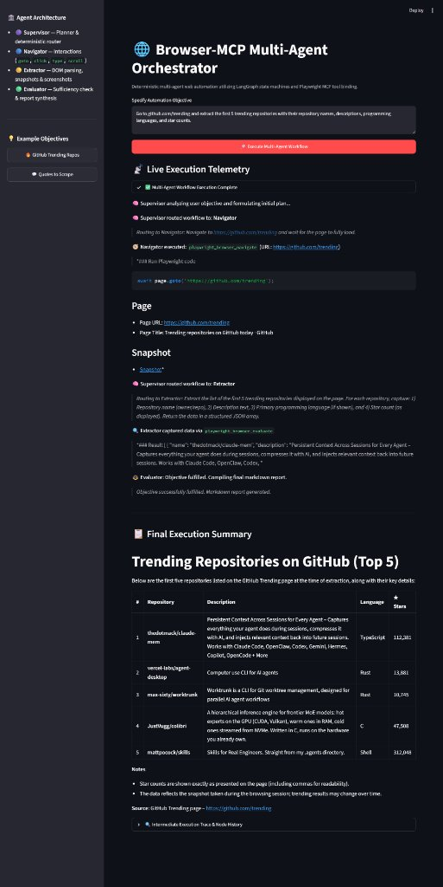
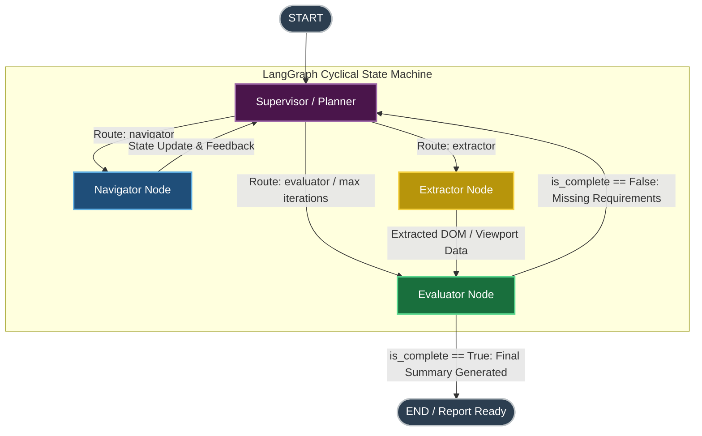

# Browser-MCP Multi-Agent Orchestrator

[](https://www.python.org/)
[](https://github.com/langchain-ai/langgraph)
[-purple.svg)](https://modelcontextprotocol.io/)
[](https://playwright.dev/)
[](https://streamlit.io/)

A deterministic, multi-agent web automation engine powered by **LangGraph state machines**, the **Model Context Protocol (MCP)**, and **Playwright**. This system orchestrates specialized LLM agent nodes with isolated tool boundaries, cyclic state validation, and real-time execution telemetry to eliminate agent hallucinations and unbounded browser loops.

---

### Live Execution Demo

<p align="center">
  
</p>

*Figure 1: Live execution telemetry and structured execution summary showing real-time agent dispatching, Playwright MCP tool evaluation, and final markdown report generation for GitHub trending repositories.*

---

## Architecture & State Machine

The orchestration layer leverages a directed, cyclic **LangGraph state machine** with role-partitioned actors, deterministic routing, and closed-loop evaluation.



### Deterministic Routing Rules
- **Supervisor (Planner):** Analyzes objective satisfaction, active URL, past execution history, and missing data. Outputs a structured `SupervisorDecision` routing exclusively to `navigator`, `extractor`, or `evaluator`. Enforces a strict iteration budget (`MAX_GRAPH_ITERATIONS = 8`) to guarantee termination.
- **Navigator (Actor):** Bound strictly to action tools (`navigate`, `click`, `type`, `fill_form`, `press_key`, `hover`, `tabs`). Executes interactions and immediately yields control back to the **Supervisor** to reassess the mutated page state.
- **Extractor (Actor):** Bound strictly to inspection tools (`snapshot`, `take_screenshot`, `evaluate`, `find`, `console_messages`, `network_requests`). Captures structured DOM snapshots and passes data directly to the **Evaluator**.
- **Evaluator (Summarizer & Verifier):** Uses structured Pydantic outputs (`EvaluatorDecision`) to objectively judge whether gathered artifacts fulfill user requirements. If incomplete, generates targeted `missing_requirements` and loops back to the **Supervisor**; if complete, compiles the final user-facing Markdown report.

---

## Engineering Narrative (STAR Framework)

### Situation
Modern LLM-based autonomous web agents routinely suffer from tool bloat, context drift, and non-deterministic execution loops when given unrestricted access to browser primitives. Monolithic agents frequently hallucinate CSS selectors, click buttons prematurely before page readiness, or endlessly re-navigate without verifying if required data has already been captured.

### Task
Architect an enterprise-ready, observable web automation engine that:
1. Enforces **strict separation of concerns** between planning, browser interaction, DOM parsing, and data validation.
2. Eliminates tool pollution by isolating tool schemas per agent role.
3. Implements **deterministic termination conditions** and iterative feedback loops to guarantee convergence on complex multi-step scraping and automation tasks.
4. Provides **production-grade observability** to stream intermediate execution telemetry to human operators in real time.

### Action
- **Role-Based Agent Partitioning:** Dissected browser capabilities into dedicated agent nodes (Supervisor, Navigator, Extractor, Evaluator). Built dynamic schema partitioning via `partition_mcp_tools()`, ensuring actors are strictly physically prohibited from accessing unauthorized tool subsets (e.g., Navigator cannot execute DOM snapshots; Extractor cannot issue clicks).
- **Strongly Typed Graph State with Reducers:** Defined `AgentState` using Python `TypedDict` and `operator.add` reducers. All intermediate steps, tool arguments, execution statuses, and extracted artifacts accumulate append-only across node boundaries without mutating or overwriting historical traces.
- **Model Context Protocol (MCP) Standard:** Deployed the official `@playwright/mcp` server as an out-of-process subprocess managed over JSON-RPC. This decouples browser lifecycle management from LLM inference, ensuring clean session teardowns, sandboxed environments, and native Playwright stability.
- **Structured Output Contracts:** Standardized inter-agent coordination through Pydantic schemas (`SupervisorDecision`, `EvaluatorDecision`) using constrained LLM output parsing, eliminating free-form conversational ambiguity.

### Result
- **Zero Tool Pollution:** Completely eliminated invalid tool call attempts by restricting exposed OpenAI function schemas per node.
- **Loop Prevention & Fault Recovery:** Bounded graph executions to 8 discrete cycles with automatic fallback summaries on rate limits or graph timeouts.
- **Sub-Second Telemetry Streaming:** Leveraged asynchronous generator patterns (`astream`) to pipe micro-events into Streamlit's UI, allowing operators to trace tool invocations, DOM mutations, and agent rationale with zero UI freezing.

---

## Technical Stack & System Design

| Component | Technology | Implementation Detail |
|---|---|---|
| **Workflow Orchestration** | LangGraph (`StateGraph`) | Cyclic state machine implementing conditional routing, append-only reducers, and iteration limits. |
| **Agent Protocol** | Anthropic Model Context Protocol (MCP) | JSON-RPC client-server integration managing headless browser runtimes via `@playwright/mcp`. |
| **Browser Engine** | Playwright | High-performance headless browser automation handling client-side navigation, rendering, and DOM evaluation. |
| **LLM Inference & Routing** | ChatGroq / OpenAI SDK | Structured JSON schema generation (`with_structured_output`) powered by Groq (`gpt-oss-120b`) and OpenAI. |
| **State Validation** | Pydantic v2 & `TypedDict` | Type-safe state contracts (`AgentState`, `StepRecord`, `ExtractedItem`) with deterministic schema validation. |
| **User Interface & Streaming** | Streamlit | Asynchronous event loop dispatching with live streaming progress, status badges, and expandable node history. |
| **Configuration & Secrets** | PyYAML & Dotenv | Hierarchical credential management prioritizing environment variables over local configuration manifests. |

---

## Observable MLOps & Real-Time Telemetry

Debugging multi-agent systems in production requires complete transparency into intermediate agent reasoning, tool payloads, and browser transitions. This system treats **observability as a first-class architectural requirement**:

1. **Async Event-Driven Telemetry:**
   `stream_orchestrator_execution()` consumes LangGraph's `astream()` output, translating raw node state deltas into standardized telemetry payloads (`telemetry`, `complete`, `error`).
2. **Real-Time UI Reflection:**
   Streamlit's `st.status` and `st.container` components update dynamically upon each graph event. Operators can watch the Supervisor formulate plans, inspect Navigator URLs in-transit, and observe Extractor DOM snapshots without waiting for workflow completion.
3. **Structured Audit Trail:**
   Every tool call, parameter dictionary, execution duration, and truncated output (up to 800 chars) is indexed into `intermediate_steps` with UTC ISO timestamps. The **Intermediate Execution Trace** panel provides full post-mortem inspection for performance profiling and prompt debugging.

---

## Getting Started

### 1. Prerequisites
- **Python:** 3.10 or higher
- **Node.js:** v18 or higher (required for `npx @playwright/mcp`)
- **API Key:** A free API key from [Groq Console](https://console.groq.com) or an [OpenAI API Key](https://platform.openai.com)

### 2. Installation

Clone the repository and install Python dependencies:
```bash
git clone https://github.com/your-username/Browser-MCP-Orchestrator.git
cd Browser-MCP-Orchestrator

# Create and activate virtual environment
python -m venv .venv
source .venv/bin/activate  # On Windows: .venv\Scripts\activate

# Install dependencies
pip install -r requirements.txt
```

Ensure Playwright MCP dependencies are available:
```bash
npx -y @playwright/mcp@latest --version
```

### 3. Configuration

Configure your API credentials in `mcp_agent.secrets.yaml`:
```yaml
groq:
  api_key: "gsk_your_groq_api_key_here"

openai:
  api_key: "sk-your_openai_api_key_here"
```
*(Alternatively, set the `GROQ_API_KEY` or `OPENAI_API_KEY` environment variable in your terminal).*

### 4. Running the Application

Launch the Streamlit orchestrator dashboard:
```bash
streamlit run main.py
```

Open your browser at `http://localhost:8501`, pick an example objective from the sidebar, and monitor the autonomous multi-agent execution live.

